# CAMBIOS · Jornadas del Sur

Corrección de mantenimiento sobre el proyecto base. Se conservan Retrofit + `ServicioLocal` (interceptor de OkHttp), Room/SQLite, la pantalla Mesa y `legacy/AgendaImpresa`. No se cambiaron versiones de Gradle (8.7), del plugin de Android (8.5.2) ni de Kotlin (1.9.24).

| Commit | Contenido |
| --- | --- |
| Estado inicial del profe | Proyecto base + `.gitignore` (incluye la dependencia `converter-gson` que faltaba para compilar) |
| Pedido 41 | Programa sin señal con edición guardada |
| Pedido 42 | Agenda personal conserva marcas entre ediciones |
| Pedido 43 | Volver al punto de lectura |
| Pedido 44 | Control de descargas |
| Tests | Tests unitarios de vista, filtros y control de descargas |

Compilación: `gradlew.bat assembleDebug testDebugUnitTest` con JDK 21 (`~/.jdks/temurin-21.0.6`). El JBR de Android Studio es Java 25 y Gradle 8.7 no lo soporta.

---

## Pedido 41 · Programa sin señal

**Problema.** En `Catalogo.kt`, cuando había un aviso de error, el `else` ocultaba la lista. Además, no había forma de distinguir "nunca se descargó" de "se descargó una edición con cero charlas", y como `guardar` hacía `INSERT REPLACE` sin borrar nada, una v4 vacía dejaba visibles las charlas viejas.

**Cambio.**
- Nueva tabla `edicion` (una fila) en Room. `Archivo` pasa a versión 2 con `MIGRACION_1_2`, que crea la tabla sin tocar `charlas`. Si el usuario ya tenía charlas descargadas, se registra una edición válida para conservar sus datos al actualizar.
- `CarteleraDao.reemplazarEdicion` (`@Transaction`) trata cada respuesta como instantánea completa: retira las ausentes, guarda las vigentes y registra la edición.
- `armarVista(hayEdicion, charlas, fallo)` en `ui/VistaPrograma.kt` decide entre tres estados: lista + «Sin conexión: se están usando datos guardados», «No se pudo descargar el programa» + Reintentar, o «Sin charlas programadas».

| Antes | Después |
| --- | --- |
| 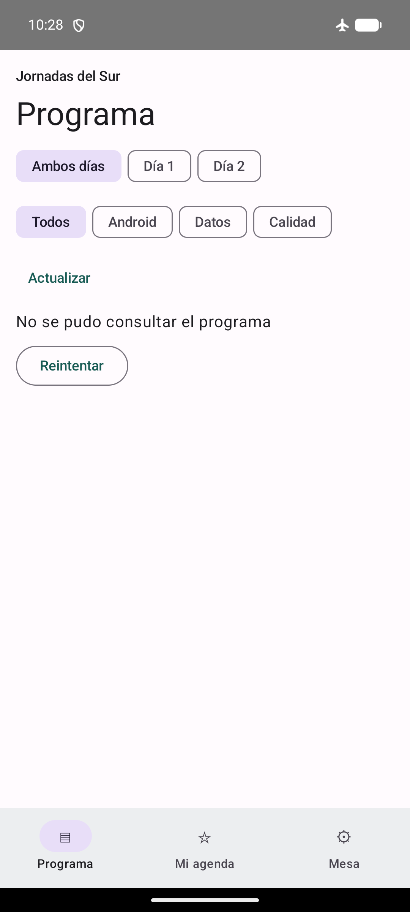 Una falla oculta la lista | 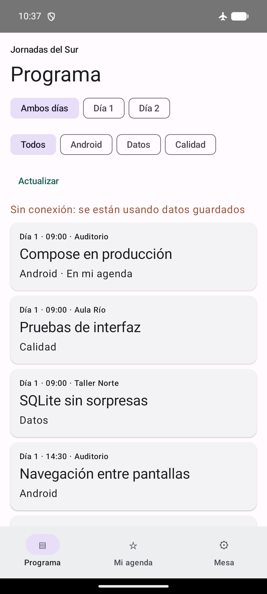 La lista se conserva con el aviso |
| 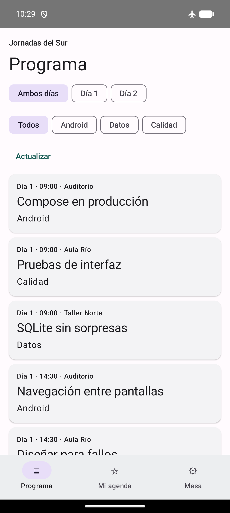 La v4 vacía sigue mostrando charlas | 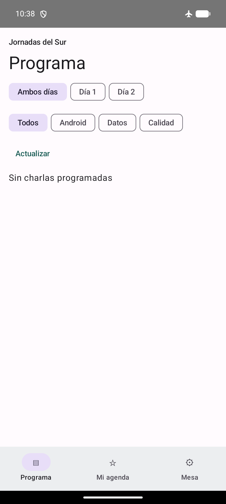 «Sin charlas programadas» |

Otras evidencias: `41_antes_1_lista_v1.png`, `41_antes_2_mesa_sin_servicio.png`, `41_despues_2_falla_conserva_favoritas.png` (Mi agenda intacta sin señal), `41_despues_3_sin_descarga_reintentar.png` (arranque vacío sin señal → Reintentar), `41_despues_5_v4_reabierta_sin_senal.png` (la v4 sigue siendo válida al reabrir sin señal).

## Pedido 42 · Agenda personal

**Problema.** `@Insert(onConflict = REPLACE)` borra la fila y la vuelve a crear con `favorita = false`, así que cada actualización perdía las marcas. Las charlas retiradas nunca se borraban (la 11 seguía en v3).

**Cambio.** `reemplazarEdicion` ahora, dentro de una transacción:
1. `retirarAusentes`: borra las charlas que no vienen. Si una charla vuelve más adelante, vuelve como fila nueva y sin marcar.
2. `actualizarContenido`: hace un `UPDATE` por id estable de título, sala, etc. **sin tocar `favorita`**. Como la marca se lee de la fila en el momento de escribir, una marca agregada o quitada durante la petición se respeta.
3. `insertarNuevas`: `INSERT IGNORE`, para agregar solo las charlas nuevas.

| Antes | Después |
| --- | --- |
| 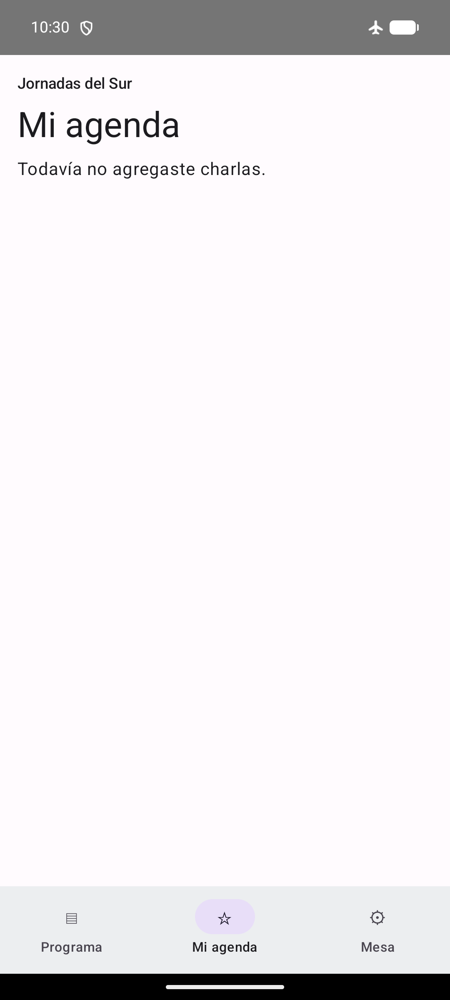 En v2 se pierden las marcas | 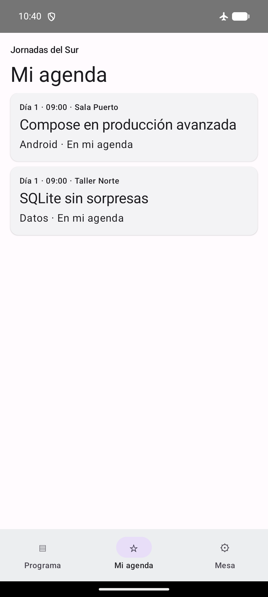 La 11 conserva la marca con «Compose en producción avanzada» / «Sala Puerto» |
| 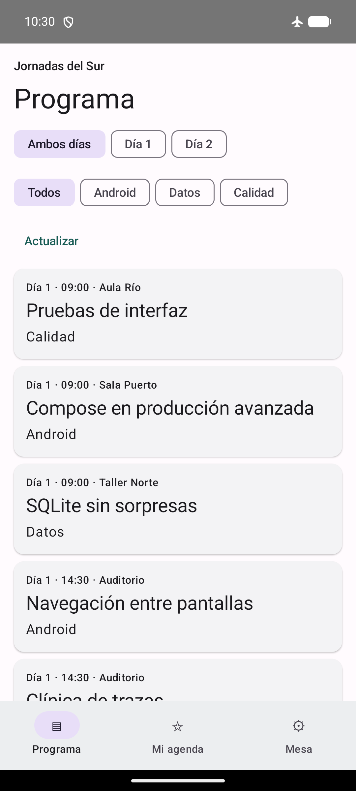 En v3 la 11 sigue | 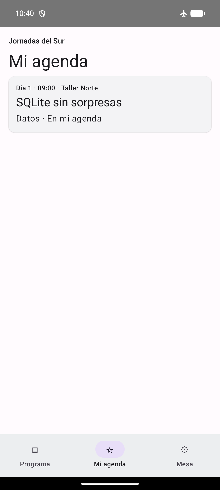 La 11 sale de Mi agenda y se conserva la marca de SQLite |

Otras evidencias: `42_antes_1_agenda_v1.png`, `42_antes_3_programa_v2_titulo_nuevo.png`, `42_despues_1_agenda_v1.png`, `42_despues_3_ficha11_v2.png`, `42_despues_4_programa_v3.png`, `42_despues_6_v3_entra_90.png` (entra «Clínica de trazas»), `42_despues_7_11_regresa_sin_marca.png` (v3 → v2: la 11 vuelve sin marcar), `42_despues_8_marca_durante_peticion.png` y `42_despues_9_marcas_respetadas_tras_respuesta.png` (con demora larga, se agregó «Pruebas de interfaz» y se quitó «SQLite» durante la petición; ambas se respetan).

## Pedido 43 · Volver al punto de lectura

**Problema.** El tema se guardaba con `remember` dentro de `Catalogo`: se perdía al abrir una ficha (el catálogo sale de la composición) y al rotar. El día estaba en un `MutableStateFlow` del ViewModel, que se pierde cuando Android mata el proceso.

**Cambio.** `ProgramaModel` recibe `SavedStateHandle` y expone `dia` y `tema` con `getStateFlow`, más `elegirDia` y `elegirTema`. El estado guardado sobrevive a la rotación, a abrir una ficha y a la muerte del proceso; una tarea nueva no tiene estado guardado y arranca sin filtros. La ficha y la pestaña ya usaban `rememberSaveable`. El filtrado se extrajo a la función pura `filtrar(charlas, dia, tema)`.

| Antes | Después |
| --- | --- |
| 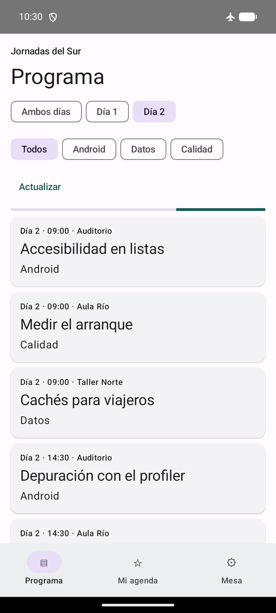 Al volver, el tema queda en «Todos» | 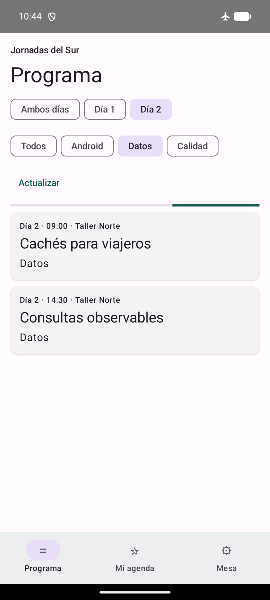 Día 2 + Datos, dos resultados |
| 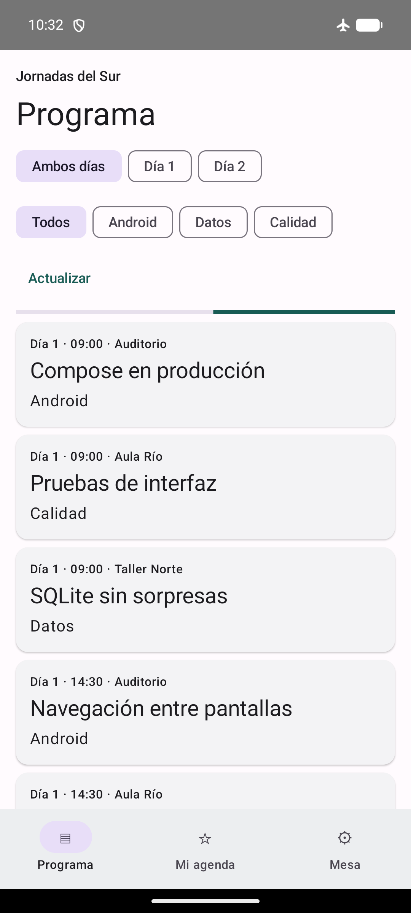 Tras `am kill`, ambos filtros se pierden | 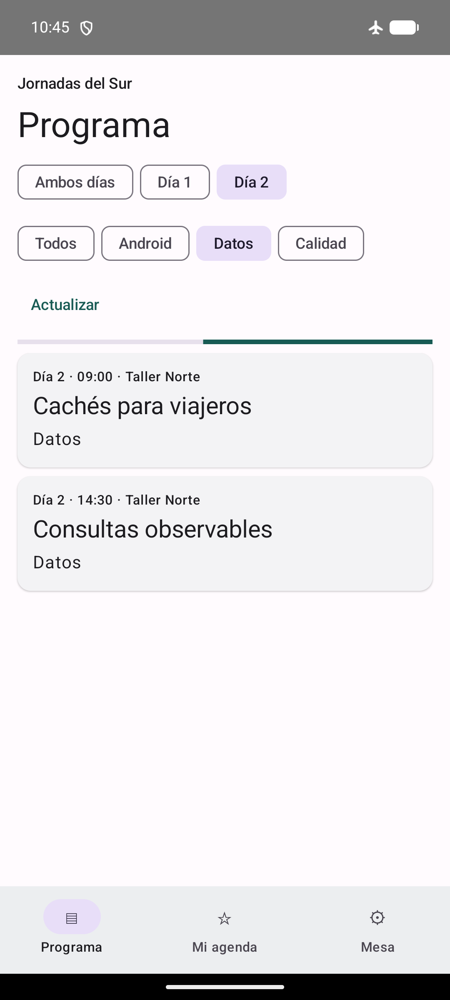 Se recuperan la ficha y ambos filtros |

Otras evidencias: `43_antes_1/3/4/5`, `43_despues_1_filtros_dia2_datos.png`, `43_despues_3_rotado.png`, `43_despues_4_ficha_abierta.png`, `43_despues_5_tras_matar_proceso.png` (se recupera «Cachés para viajeros»), `43_despues_7_tarea_nueva_sin_filtros.png`.

## Pedido 44 · Control de descargas

**Problema.** `recargar()` se llamaba en `MainActivity.onStart()` (cada rotación o vuelta del fondo) y en un `LaunchedEffect` de `Catalogo` (cada vez que se entraba a la pestaña o se volvía de una ficha). No había protección contra toques repetidos. El arranque ya hacía 2 peticiones.

**Cambio.**
- Se quitan las dos llamadas automáticas. `MainActivity.onCreate` llama a `model.cargaInicial()` después de aplicar el extra `servicio_disponible`.
- `cargaInicial()` usa una marca `UnaVez` en el `companion object` del ViewModel, que vive lo mismo que el proceso: hay una sola carga automática por sesión.
- `ControlDescargas` guarda el `Job` en curso; `pedir` no lanza otra descarga mientras `enCurso`. Al terminar, con éxito o con falla, se puede volver a pedir. Los filtros no se bloquean.

| Medición en Mesa | Antes | Después |
| --- | --- | --- |
| Arranque | 2 | 1 |
| + 2 rotaciones | 4 | 1 |
| + ficha y cambio de pestañas | 7 | 1 |
| 2 toques durante la petición | +2 | +1 |

Evidencias: `44_antes_1_arranque.png`, `44_antes_2_tras_rotar_ficha_pestanas.png`, `44_antes_3_dos_toques_cargando.png`, `44_antes_4_contador_dos_toques.png`, `44_despues_1_arranque.png`, `44_despues_2_tras_rotar_ficha_pestanas.png`, `44_despues_3_dos_toques_filtros_editables.png` (filtros cambiados durante la espera), `44_despues_4_contador_dos_toques.png`, `44_despues_5_repedir_tras_exito_y_falla.png`.

## Test unitario

`app/src/test/java/ar/jornadas/ui/` (JUnit 4, solo `testImplementation`):
- `VistaProgramaTest`: estados del pedido 41 (falla con y sin edición previa, edición vacía con y sin señal) y `filtrar` del pedido 43.
- `ControlDescargasTest`: pedido 44, con dos pedidos durante una descarga (un solo intento), la posibilidad de volver a pedir tras éxito o falla, y la carga automática que se reclama una sola vez.

Resultado: 9 tests, 0 fallas (`evidencias/tests_resultado.txt`).
